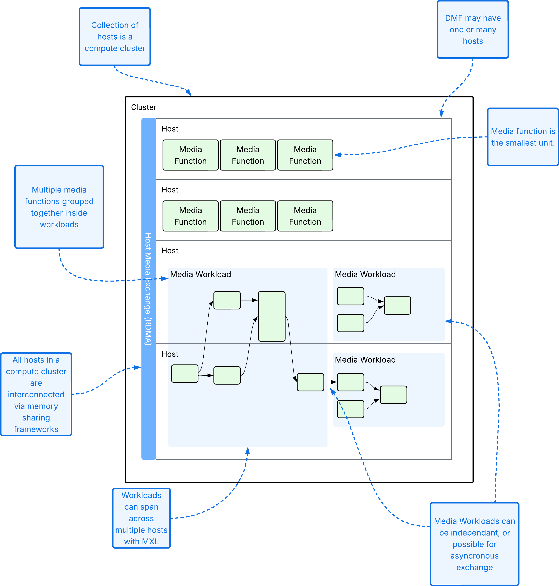

# DMF Latency & Sync Visualizer

## Why this exists

An interactive, browser-based tool for testing and working with latency and
synchronization in the EBU's Dynamic Media Facility (DMF). 

A DMF has linear, synchronous boundaries (Ingress and Egress) around an 
asynchronous domain, and inside that asynchronous domain behaviour follows 
the Media eXchange Layer (MXL; normative source: https://github.com/dmf-mxl/mxl). 

**Version 0.2** — combines the JT-DMF Sync Group discussions into the tool: per-writer ring buffers with reader pointers, a many-readers scenario, a blank canvas to build on, and saved scenarios.

### How It Works
Users wire Media Function nodes between an Ingress and an Egress and watch, in real
time, how media flows (grains) move through the workflow: a flow's grain
index is preserved through processing while its published head lags, and
that differential lag can cause a faster sibling flow's grain to be
overwritten before a sync point can read it ("too late"). The goal is to
isolate where latency builds up and where overruns can happen, building an
intuition for DMF/MXL timing that's hard to get from documentation alone:
latency by itself is harmless; it's the *differential* latency between flows
that must be re-paired that destroys data.

This tool models a DMF; it is not MXL. Inside the asynchronous domain it must
follow MXL: where this repo and
[dmf-mxl/mxl](https://github.com/dmf-mxl/mxl) disagree, dmf-mxl/mxl is
correct.

### Basic Definitions

*Figure 1: The unoffical DMF definitions*

### Using the canvas

- Add functions from the **Add node** palette (audio-only functions, a Video Mixer and multi-input mixers included) and drag between handles to connect them.
- Every media function carries its own ring buffers, drawn as part of its block. The function writes into them whether or not anything reads. Each reader appears as a pointer showing how far behind the write head it reads; click a pointer or a function to highlight that reader's link.
- Inputs and Outputs can be video only, audio only or both. Audio readers read only audio and video readers only video. An input takes one link (drop a new one on it to replace it).
- The toolbar has **Undo** (also Ctrl/Cmd+Z) and **Now**, which shows how far behind real time each writer is.
- Scenario 6, "Blank Canvas", starts empty. The Scenarios page (`#/scenarios`) saves and reopens your own.

## Getting started after cloning this repo

```bash
npm install
npm run dev
```

This starts the Vite dev server. Open the URL it prints — by default:

```
http://localhost:5173/
```

Other commands:

```bash
npm run build     # type-check + production build
npm run lint      # eslint
npm test          # vitest
```

Requires Node 18 (do not upgrade Vite/tooling to a version requiring Node ≥20
without checking first — see `AI_RULES.md`).

## Reference docs

- `SPEC.md` — domain specification (how this tool models MXL)
- `AI_RULES.md` — coding conventions, architecture, and current project status
- `SBOM.md` — open-source dependencies and licenses
- `TO-DO.md` — feature backlog and known bugs
